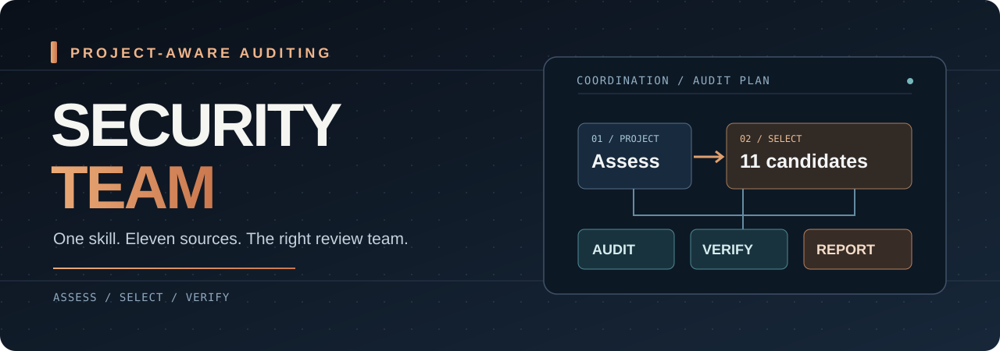
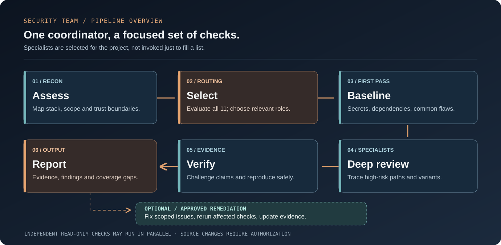

<p align="center">
  
</p>

<h1 align="center">Security Team</h1>
<p align="center"><strong>One skill. The right security team.</strong></p>
<p align="center">Project-aware security reviews, coordinated by Codex.</p>
<p align="center">
  
  
  
</p>
<p align="center"><strong>English</strong> · <a href="README.vi.md">Tiếng Việt</a></p>
<p align="center">
  <a href="#quick-start">Quick start</a> ·
  <a href="#pipeline-overview">Pipeline</a> ·
  <a href="#meet-the-toolkit">Toolkit</a> ·
  <a href="#installation">Installation</a> ·
  <a href="#documentation">Documentation</a>
</p>

---

Security Team helps you answer **“Which security tools does this project actually need?”** It guides Codex to inspect the project, choose relevant methods and tools from an eleven-repository catalog, order the work, challenge findings, and produce one evidence-based report.

You describe the goal. Codex coordinates the work. Each selected tool gets a bounded role; irrelevant or unavailable tools are recorded with a reason.

> [!NOTE]
> This is an **instruction-based skill with setup helpers**, not a standalone scanner or an already integrated eleven-tool runtime. Selected upstream tools need their own prerequisites and compatible host integrations. Full end-to-end integration has not yet been tested.

## Quick start

You need **Git**, **PowerShell**, and **Codex with access to your project**. The coordinating skill itself needs no Python, Node.js, Docker, or separate API key. Your agent's normal model usage and data policies still apply.

Run in PowerShell:

```powershell
git clone https://github.com/imnwngr/security-team.git
Set-Location security-team

# Validate the package, preview the install, then install the skill.
& .\scripts\Test-Package.ps1
& .\scripts\Install-Skill.ps1 -WhatIf
& .\scripts\Install-Skill.ps1

# Download the eleven upstream source repositories. No dependencies installed.
& .\scripts\Get-Toolkit.ps1 -WhatIf
& .\scripts\Get-Toolkit.ps1
```

Open your project in Codex and start with a plan:

```text
$security-team assess this project and recommend the right security team.
My toolkit is in Documents/Security-Toolkit.
Identify relevant tools, missing prerequisites, and the review order.
Plan only. Do not run scanners or edit source files.
```

When ready to audit:

```text
$security-team audit this project using the plan.
Run the permitted checks and produce an English report. Do not edit source.
Continue independent checks if a tool is missing, and report coverage gaps.
```

The installer copies the complete skill to `~/.agents/skills/security-team`. It refuses to overwrite an existing installation. Restart Codex if the skill does not appear. See [installation](#installation) for project-local and manual options.

## What the skill coordinates

| Decision | What happens |
|---|---|
| Understand the project | Identify the stack, entry points, sensitive data, trust boundaries and source revision. |
| Choose the team | Consider all eleven repositories; record selected, redundant, not applicable, unavailable or approval-required roles. |
| Bound the work | Give each check a scope, prerequisites, allowed actions and expected evidence. |
| Challenge the findings | Trace claims through source, evaluate existing defenses and distinguish proof from uncertainty. |
| Join the results | Deduplicate by root cause while preserving affected locations, tool provenance and coverage gaps. |
| Fix when requested | Apply scoped changes, run relevant regression checks and revisit affected evidence. |

A comprehensive audit expands relevant coverage. It does not launch eleven full orchestrators or count missing tools as completed checks.

## Pipeline overview

<p align="center">
  
</p>

| Stage | Job | Evidence |
|---|---|---|
| **01 · Assess** | Map the project, permissions and installed capabilities. | `project-profile.md` |
| **02 · Select** | Build the threat model, choose specialists and record all eleven selection decisions. | `audit-plan.md` |
| **03 · Baseline** | Check relevant secrets, dependencies and common vulnerabilities. | Raw results and candidate findings |
| **04 · Deep review** | Examine high-risk paths with the primary audit procedure and selected specialists. | Source traces and `coverage.json` |
| **05 · Verify** | Challenge candidates; run scoped reproductions when permitted and available. | Finding evidence and unresolved facts |
| **06 · Report** | Combine findings, priorities, provenance and coverage gaps. | `findings.json` and `REPORT.md` |
| **Optional · Fix & recheck** | Make requested changes and verify their effects. | Diff, regression results and updated evidence |

Independent read-only checks can run in parallel on the same source snapshot. Runtime validation depends on a scoped target and suitable isolation. If independent verification is unavailable, the report must say so.

<details>
<summary>Text version of the pipeline</summary>

```text
Your project
  -> assess stack, scope and available capabilities
  -> select relevant roles from all 11 repositories
  -> model threats and order the checks
  -> baseline scans + deep review
  -> challenge findings and verify evidence
  -> report confirmed issues, uncertainty and coverage gaps
  -> optional requested fixes + regression checks
```

</details>

## Meet the toolkit

These repositories provide methods or tools, not independent decision authority. Codex remains the coordinator. The [routing catalog](skills/security-team/references/catalog.md) explains selection rules and limitations.

| Role | Repository | When it helps |
|---|---|---|
| Agent command protection | [CC Safety Net](https://github.com/kenryu42/cc-safety-net) | Guarding supported agent operations; separate from application audit coverage. |
| Skill and plugin inspection | [AgentGuard](https://github.com/GoPlusSecurity/agentguard) | Reviewing toolkit trust and agent-related risks. |
| Security coverage reference | [OWASP Security Skill](https://github.com/agamm/claude-code-owasp) | Relevant controls, review checklists and remediation guidance. |
| Common vulnerability pass | [vbsec](https://github.com/tanviet12/vbsec) | A bounded early review of supported application stacks. |
| Scanner evidence | [Ghost Security](https://github.com/ghostsecurity/skills) | Secrets, dependencies and optional dynamic validation. |
| Primary audit procedure | [Cloudflare Security Audit](https://github.com/cloudflare/security-audit-skill) | Broad source review with coverage accounting and verification. |
| Specialist methods | [Trail of Bits Skills](https://github.com/trailofbits/skills) | Static analysis, variants, false-positive checks and stack-specific testing. |
| Optional second opinion | [PYA](https://github.com/AgriciDaniel/pya) | Targeted independent review, including AI/MCP and supply-chain concerns. |
| Business-logic challenge | [Bug Hunter](https://github.com/codexstar69/bug-hunter) | Important authorization, payment, quota and concurrency paths. |
| Threat-model / native harness reference | [Anthropic Reference Harness](https://github.com/anthropics/defending-code-reference-harness) | Threat modeling and suitable native-code validation workflows. |
| Artifact and infrastructure review | [ptn1411 Skills](https://github.com/ptn1411/skill) | Release packages, SBOM, container/cloud configuration and relevant artifacts. |

**For a typical web/API project:** start with relevant OWASP controls, common-code checks and secret/dependency evidence; use Cloudflare's procedure with selected Trail of Bits methods for deeper review; add business-logic or artifact checks where the project warrants them.

Cloning a repository makes its source available. It does not install its scanner, activate its hooks or prove host compatibility. See the [dependency guide](docs/prerequisites.md).

## Common workflows

These are prompts for your coding agent, not terminal commands or implemented CLI flags.

| Goal | Request |
|---|---|
| Plan first | `$security-team assess this project and recommend an audit plan. Do not run scanners.` |
| Audit without edits | `$security-team audit this project. Report only; do not edit source.` |
| Review a diff | `$security-team review the current diff and affected callers for security issues.` |
| Focus on one area | `$security-team audit src/auth and its authorization boundaries.` |
| Review release artifacts | `$security-team assess the supplied release package and document source visibility limits.` |
| Verify earlier findings | `$security-team verify the previous findings and report what remains unresolved.` |
| Request fixes | `$security-team fix confirmed issues within the permitted scope, run regression checks, and do not commit or push.` |

Request a report language explicitly if needed. The skill currently defaults to Vietnamese.

## Installation

### Project-local installation

From this checkout, replace the project path:

```powershell
& .\scripts\Install-Skill.ps1 `
  -Destination 'C:\dev\my-project\.agents\skills\security-team'
```

Choose either a user-level or a project-local installation to avoid duplicate skills. Local discovery locations are documented in [OpenAI's skills guide](https://learn.chatgpt.com/docs/build-skills).

### Manual installation · macOS / Linux / Windows

Copy the **whole** `skills/security-team` directory, including `references` and `agents`. On macOS/Linux, run from this checkout:

```bash
mkdir -p "$HOME/.agents/skills"
if [ -e "$HOME/.agents/skills/security-team" ]; then
  echo "Skill already exists. Review changes and back it up before updating."
else
  cp -R skills/security-team "$HOME/.agents/skills/security-team"
fi
```

On Windows, File Explorer can copy the same directory into your user or project's `.agents/skills` folder. If organizational policy blocks scripts, use the permitted manual workflow rather than disabling protection.

### Try without installing

Ask Codex to read the absolute path to `skills/security-team/SKILL.md`, then assess your project. Other hosts may read the methodology, but their permissions and native integrations need separate evaluation; this skill is designed around Codex coordination.

## Download the upstream sources

```powershell
# Use a separate tools directory.
& .\scripts\Get-Toolkit.ps1 -Destination 'D:\Security-Toolkit'
```

The downloader clones ordinary Git history and submodules, then writes a uniquely named revision manifest. It does not install dependencies, run upstream code or activate skills. On macOS/Linux with PowerShell 7:

```bash
pwsh -File ./scripts/Get-Toolkit.ps1 -Destination /path/to/toolkit
```

Without PowerShell, clone catalog URLs with `git clone --recurse-submodules URL`, naming each directory `owner__repo`.

| Manifest status | Meaning |
|---|---|
| `cloned` | This run completed the clone and recorded its commit. |
| `existing_unverified` | The destination already existed and was left untouched. |
| `failed` | The clone failed; inspect the error and any partial directory. |

The script continues after individual clone failures and returns an error at the end if any failed. Re-running does not pull, reset or repair existing directories. Git LFS objects, release attachments, external models and dependencies require upstream-specific steps.

## Evidence and reports

| Artifact | Purpose |
|---|---|
| `project-profile.md` | Stack, source snapshot, boundaries and scope assumptions. |
| `audit-plan.md` | Selection decisions for all eleven repositories and task dependencies. |
| `coverage.json` | Completed, partial, blocked and skipped checks, with evidence. |
| `findings.json` | Normalized findings, provenance, verification and remediation status. |
| `REPORT.md` | Prioritized issues, unresolved leads, limitations and next actions. |

Survey-only runs produce the profile and plan. Audit findings distinguish `candidate`, `confirmed`, `needs_validation`, `rejected` and `fixed_verified`. A proposed patch is not a verified fix. The [report contract](skills/security-team/references/reporting.md) defines the fields; these files are agent-produced artifacts, not a bundled schema-validated runtime.

## Permissions and boundaries

- Audit runs are report-only unless fixes are requested.
- Upstream instructions cannot grant permission to install tools, change credentials, alter database schemas, commit, push or deploy.
- Runtime checks require an appropriate local/staging target and isolation; production probing needs explicit scope.
- External-worker output is advisory. Codex checks material claims against evidence.
- Missing tools, blocked tests and unreviewed areas remain visible in the report.

Zero findings does not establish that a project is secure.

## Updates and removal

Check `git status` before updating this checkout. When there are no local changes to preserve, use `git pull --ff-only`, then review the changes. The installer refuses to overwrite: back up or rename the previous installed skill before reinstalling. Update selected upstreams between audit runs and record their new commits.

To remove the skill, verify and remove only its installed `security-team` directory. This does not remove separately installed upstream tools or hooks; follow their own removal instructions.

<details>
<summary>Troubleshooting</summary>

| Symptom | What to check |
|---|---|
| Skill does not appear | Confirm `security-team/SKILL.md` is at the expected level, then restart Codex. |
| PowerShell blocks scripts | Use manual copying or your administrator-approved process. |
| Python or Node.js is missing | Install only prerequisites needed by selected upstream tasks; the coordinator itself needs neither. |
| Toolkit download is incomplete | Inspect the manifest; existing and partial directories are intentionally preserved. |
| Source is present but a tool cannot run | Check dependencies and host integration separately. |
| No independent workers or execution isolation | Continue permitted analysis and record the limitation; do not claim skipped verification ran. |

</details>

## Documentation

- [Vietnamese guide](README.vi.md)
- [Coordinator instructions](skills/security-team/SKILL.md)
- [Toolkit prerequisites](docs/prerequisites.md)
- [Selection catalog](skills/security-team/references/catalog.md)
- [Execution and worker contracts](skills/security-team/references/workflow.md)
- [Report contract](skills/security-team/references/reporting.md)
- [Validation record](VALIDATION.md)
- [Behavioral acceptance scenarios](validation-scenarios.md)

## Validation and project status

```powershell
& .\scripts\Test-Package.ps1
```

The package checks cover structure, local links, the catalog and PowerShell syntax. Installer copy behavior, overwrite refusal, preview behavior and existing-directory manifest handling have been exercised. Live end-to-end integration of the eleven upstreams has **not** been tested. See [VALIDATION.md](VALIDATION.md) for the exact scope.

This repository contains its own coordination instructions, setup helpers and documentation. Upstream source is not bundled. Each upstream retains its own license; no license has yet been selected for this repository's original content.

The README's visual direction was inspired by [Bug Hunter](https://github.com/codexstar69/bug-hunter). Security Team's artwork and workflow text were created for this project. No upstream affiliation or endorsement is implied.
