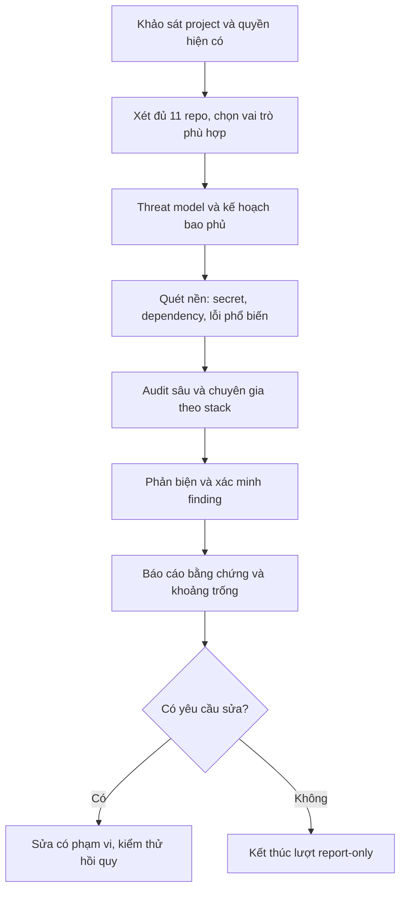

<p align="center">
  
</p>

<h1 align="center">Security Team</h1>
<p align="center"><strong>Một skill. Chọn đúng đội kiểm tra.</strong></p>
<p align="center">Quy trình rà soát bảo mật theo project, do Codex điều phối.</p>
<p align="center">
  
  
  
</p>
<p align="center"><a href="README.md">English</a> · <strong>Tiếng Việt</strong></p>

---

**Một skill để khảo sát project, tự chọn bộ công cụ bảo mật và tổ chức audit đúng thứ tự.** Bạn mô tả mục tiêu; Codex xem project cần gì, chọn từ 11 repo và tổng hợp bằng chứng thành một báo cáo.

Đây là skill dạng hướng dẫn, có script hỗ trợ cài đặt và tải source. Nó không phải scanner độc lập, không tự chạy khi chưa có coding agent và chưa có adapter thực thi được kiểm thử cho toàn bộ 11 upstream.

## Bắt đầu nhanh trên Windows

Yêu cầu ban đầu: **Git**, **PowerShell** và **Codex có quyền đọc project**. Skill điều phối không yêu cầu Python, Node.js, Docker hay API key riêng. Agent/model bạn sử dụng vẫn có chi phí và chính sách dữ liệu của nền tảng đó.

```powershell
git clone https://github.com/imnwngr/security-team.git
Set-Location security-team

# Kiểm tra bộ skill trước khi cài.
& .\scripts\Test-Package.ps1

# Xem trước, sau đó cài skill cho tài khoản hiện tại.
& .\scripts\Install-Skill.ps1 -WhatIf
& .\scripts\Install-Skill.ps1

# Tải source của 11 repo vào Documents/Security-Toolkit.
& .\scripts\Get-Toolkit.ps1 -WhatIf
& .\scripts\Get-Toolkit.ps1
```

Script cài chỉ sao chép `skills/security-team` vào `~/.agents/skills/security-team`. Không sửa cấu hình hệ thống, cài hooks hay cài dependency. Nếu đích đã tồn tại, script dừng để tránh ghi đè. Có thể đọc source script trước khi chạy. Nếu PowerShell bị chính sách của tổ chức chặn, dùng cách sao chép thủ công phía dưới; không cần tắt chính sách bảo vệ.

Mở project trong Codex rồi gửi:

```text
$security-team khảo sát project hiện tại.
Bộ công cụ nằm trong Documents/Security-Toolkit của tôi.
Tự xác định cần dùng repo nào, thiếu dependency nào và thứ tự kiểm tra.
Chỉ lập kế hoạch trước, chưa chạy scanner hoặc sửa source.
```

Sau khi xem kế hoạch:

```text
$security-team audit project theo kế hoạch.
Thực hiện các kiểm tra được phép, báo cáo bằng tiếng Việt, chưa sửa source.
Nếu thiếu công cụ thì tiếp tục phần độc lập và ghi rõ khoảng trống.
```

## Cài đặt skill

### Cài cho một project

Chạy từ thư mục clone `security-team`, thay đường dẫn project:

```powershell
& .\scripts\Install-Skill.ps1 `
  -Destination 'C:\dev\my-project\.agents\skills\security-team'
```

Chọn cài cấp người dùng hoặc cấp project, tránh cài trùng hai bản cùng tên. Các vị trí được đối chiếu với [tài liệu local skills của OpenAI](https://learn.chatgpt.com/docs/build-skills). Nếu chưa thấy skill trong danh sách, khởi động lại Codex.

### Sao chép thủ công / macOS / Linux

Sao chép **nguyên thư mục** `skills/security-team`, bao gồm `references` và `agents`; không chỉ lấy `SKILL.md`. Ví dụ chạy từ thư mục repo trên macOS/Linux:

```bash
mkdir -p "$HOME/.agents/skills"
if [ -e "$HOME/.agents/skills/security-team" ]; then
  echo "Skill đã tồn tại; hãy xem diff và sao lưu trước khi cập nhật."
else
  cp -R skills/security-team "$HOME/.agents/skills/security-team"
fi
```

Trên Windows cũng có thể dùng File Explorer để sao chép vào thư mục `.agents/skills` của tài khoản hoặc project. Không cần chạy script để sử dụng skill.

### Dùng ngay mà không cài

Yêu cầu Codex đọc đường dẫn tuyệt đối đến `skills/security-team/SKILL.md`, rồi khảo sát project. Cách này cũng phù hợp khi muốn thử trước. Host khác có thể đọc phương pháp, nhưng quyền điều phối và tích hợp native của từng công cụ phải được đánh giá riêng; bản này được thiết kế với Codex điều phối.

## Tải 11 repo: source khác với công cụ đã cài

`Get-Toolkit.ps1` clone đầy đủ lịch sử Git thông thường và submodule, không dùng shallow clone. Script tạo manifest JSON chứa commit, đường dẫn và trạng thái từng repo; repo lỗi được ghi nhận và script tiếp tục tải những repo còn lại.

```powershell
# Chọn nơi lưu riêng.
& .\scripts\Get-Toolkit.ps1 -Destination 'D:\Security-Toolkit'

# Chỉ kiểm tra/cài thử skill vào thư mục riêng, không kích hoạt toàn cục.
& .\scripts\Install-Skill.ps1 -Destination '.\local-test\security-team'
```

Khi chạy lại downloader, các thư mục đã tồn tại được bỏ qua và ghi `existing_unverified`; script không tự pull, reset hay sửa chúng. Hãy xem manifest: chỉ `cloned` là bản clone được hoàn tất trong lượt đó. Git LFS, file đính kèm Releases, model và dependency không nằm trong cam kết tải đầy đủ của script. Nếu upstream dùng các phần này, làm theo tài liệu của đúng phiên bản đó.

Có PowerShell 7 trên macOS/Linux thì có thể chạy script bằng `pwsh -File ./scripts/Get-Toolkit.ps1 -Destination /path/to/toolkit`. Nếu không, clone từng URL trong [danh mục](skills/security-team/references/catalog.md) bằng `git clone --recurse-submodules URL`, đặt thư mục theo dạng `owner__repo`.

## Các thành phần cần thiết sau khi khảo sát

**Không cần cài cả 11 bộ để bắt đầu.** Cài skill điều phối trước, tải source tham khảo khi cần, rồi để skill lập danh sách prerequisite theo project. Mỗi bản upstream có thể đổi cách cài; đọc README của commit đã tải trước khi thực thi.

| Repo | Vai trò | Chuẩn bị khi được chọn |
|---|---|---|
| [cc-safety-net](https://github.com/kenryu42/cc-safety-net) | Bảo vệ thao tác của agent | Node.js theo yêu cầu upstream và tích hợp hooks đúng host; không phải scanner ứng dụng |
| [agentguard](https://github.com/GoPlusSecurity/agentguard) | Đánh giá skill/plugin, bảo vệ agent | Runtime/package theo upstream; cloud và lịch chạy không bắt buộc cho việc đọc skill |
| [claude-code-owasp](https://github.com/agamm/claude-code-owasp) | Checklist và tiêu chí đánh giá | Có thể đọc thư mục skill cùng tài liệu tham chiếu; không cần dịch vụ riêng để đọc |
| [vbsec](https://github.com/tanviet12/vbsec) | Kiểm tra lỗi phổ biến | Skill và agent hỗ trợ; kiểm tra stack có nằm trong phạm vi hỗ trợ |
| [Ghost Security](https://github.com/ghostsecurity/skills) | Secret, dependency, code, xác minh động | Cài công cụ cụ thể theo upstream; kiểm tra nhu cầu mạng, proxy và môi trường local/staging |
| [Cloudflare security-audit](https://github.com/cloudflare/security-audit-skill) | Quy trình audit chính | Node.js cho validator; khả năng phân công agent và môi trường cách ly cho thực thi target |
| [Trail of Bits](https://github.com/trailofbits/skills) | Chuyên gia theo vấn đề/stack | Chỉ cài plugin và tool thực sự chọn, ví dụ Semgrep/CodeQL hoặc fuzzer khi phù hợp |
| [PYA](https://github.com/AgriciDaniel/pya) | Góc nhìn audit độc lập | Native plugin cần môi trường Claude Code phù hợp; dùng phương pháp đọc tài liệu phải ghi rõ |
| [Bug Hunter](https://github.com/codexstar69/bug-hunter) | Lỗi logic, runtime, phản biện | Cài theo host thực tế; giữ report-only khi chưa yêu cầu sửa, không auto-commit |
| [Anthropic reference harness](https://github.com/anthropics/defending-code-reference-harness) | Threat model, harness chuyên biệt | Đọc phương pháp không cần chạy harness; chạy harness cần Python/Docker/gVisor và quyền truy cập model theo upstream |
| [ptn1411/skill](https://github.com/ptn1411/skill) | Artifact, SBOM, cloud/container | Python 3.10+ cho CLI; tool ngoài như JADX/Nmap/asar chỉ khi module tương ứng cần |

Hai ví dụ cài dependency **tùy chọn**, chỉ sau khi đã đọc upstream và chấp thuận tác động:

```powershell
# Trong bản clone ptn1411__skill: tạo môi trường Python riêng.
python -m venv .venv
& .\.venv\Scripts\python.exe -m pip install -r requirements.txt
```

```powershell
# Guard tùy chọn: cài hooks vào coding CLI và kiểm tra hoạt động.
# Lệnh này thay đổi cấu hình agent; không thuộc bước tải source.
npx -y cc-safety-net@latest install
npx -y cc-safety-net@latest doctor
```

Không chạy đồng thời hai bộ hooks mà chưa kiểm tra tương thích. Không tự thay đổi credential, schema, commit, push hay deploy trong một lượt audit. Chính sách và quyền của người dùng vẫn quyết định thao tác được phép.

## Cách đội kiểm tra phối hợp

<p align="center">
  
</p>

<details>
<summary>Sơ đồ Mermaid</summary>



</details>

Codex điều phối một hàng đợi công việc. Các repo cung cấp phương pháp/công cụ cho từng giai đoạn; không khởi chạy 11 bộ điều phối đầy đủ lồng nhau. Việc xét đủ 11 luôn được ghi trong kế hoạch, nhưng kỹ thuật không phù hợp sẽ được bỏ qua có lý do.

### Các cách gọi thường dùng

```text
$security-team khảo sát project và đề xuất kế hoạch, chưa chạy kiểm tra.
```

```text
$security-team audit toàn diện source, cấu hình và dependency của project này.
Không quét production, không sửa source. Ghi rõ phần chưa kiểm tra được.
```

```text
$security-team review bảo mật phần diff hiện tại và các đường gọi bị ảnh hưởng.
```

```text
$security-team xác minh các finding trong báo cáo trước, sau đó sửa những lỗi
đã xác nhận trong phạm vi được phép và chạy test liên quan. Không commit/push.
```

## Báo cáo nhận được

| File | Nội dung |
|---|---|
| `project-profile.md` | Stack, snapshot source, bề mặt tấn công, giả định và phạm vi |
| `audit-plan.md` | Quyết định dùng/bỏ qua đủ 11 repo, thứ tự và prerequisite |
| `coverage.json` | Phần đã kiểm tra, chưa kiểm tra, bị chặn và bằng chứng |
| `findings.json` | Finding đã chuẩn hóa, trạng thái, nguồn, xác minh và bản vá |
| `REPORT.md` | Kết quả tiếng Việt, lỗi ưu tiên, hạn chế và bước tiếp theo |

Chế độ khảo sát chỉ tạo profile và kế hoạch. Công cụ không chạy được không được tính là đã kiểm tra. Không dùng số lượng finding hay điểm số làm chứng nhận project an toàn.

## Cập nhật và gỡ cài đặt

Trước khi cập nhật repo, kiểm tra `git status`; khi không có thay đổi cục bộ cần giữ, dùng `git pull --ff-only`. Xem diff trước khi áp dụng bản skill mới. Installer không ghi đè bản đã cài: sao lưu hoặc đổi tên bản cũ rồi cài lại. Với upstream, cập nhật từng repo được chọn giữa các lượt audit và ghi lại commit mới; không tự nâng cấp trong lúc audit.

Để gỡ skill, xóa đúng thư mục `security-team` đã cài sau khi kiểm tra đường dẫn. Gỡ skill này không gỡ upstream, dependency hoặc hooks đã cài riêng; thực hiện theo tài liệu của từng công cụ.

## Xử lý lỗi thường gặp

- **Không thấy skill:** kiểm tra thư mục `security-team/SKILL.md`, tránh lồng thêm một thư mục; khởi động lại Codex nếu cần.
- **Script bị chặn:** dùng cách copy thủ công hoặc quy trình được quản trị viên cho phép; không cần đổi execution policy toàn máy.
- **Không tìm thấy Git/Python/Node:** chỉ cài thành phần cần cho tác vụ đang chọn; thiếu Python không ngăn dùng skill điều phối.
- **Toolkit tải chưa đủ:** xem manifest JSON và lỗi từng repo; bản clone dở được để nguyên để kiểm tra, không tự xóa.
- **Có source nhưng tool chưa chạy được:** source, dependency và tích hợp host là ba bước riêng. Yêu cầu skill lập bảng readiness.
- **Không có subagent hoặc isolation cần thiết:** chuyển sang phần phân tích được phép, ghi rõ giới hạn; không giả lập rằng verifier độc lập đã chạy.

## Kiểm tra và giới hạn

Chạy `scripts/Test-Package.ps1` để kiểm tra cấu trúc, liên kết và danh mục. Xem [VALIDATION.md](VALIDATION.md) cho kết quả thực tế và [validation-scenarios.md](validation-scenarios.md) cho các ca nghiệm thu hành vi.

Chưa kiểm thử end-to-end cả 11 upstream trên project thật. Danh mục là mô tả từ tài liệu, không phải chứng nhận chất lượng. Repo này không chứa source bên thứ ba và không có quan hệ đại diện chính thức với các tác giả upstream. Giấy phép của mỗi upstream áp dụng riêng. Repo hiện chưa chọn giấy phép phân phối cho phần nội dung riêng.
